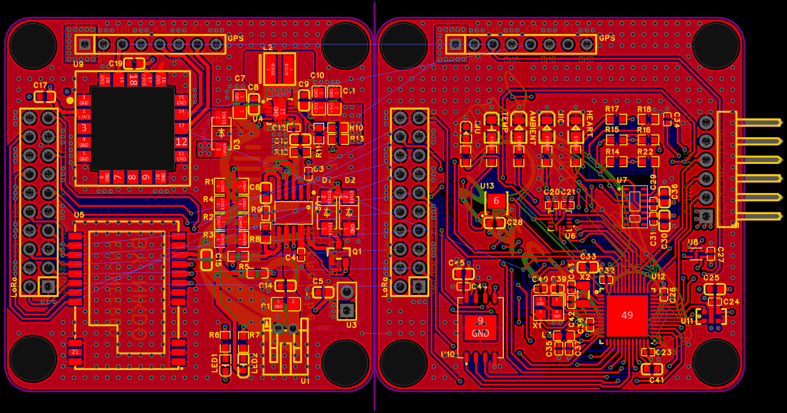
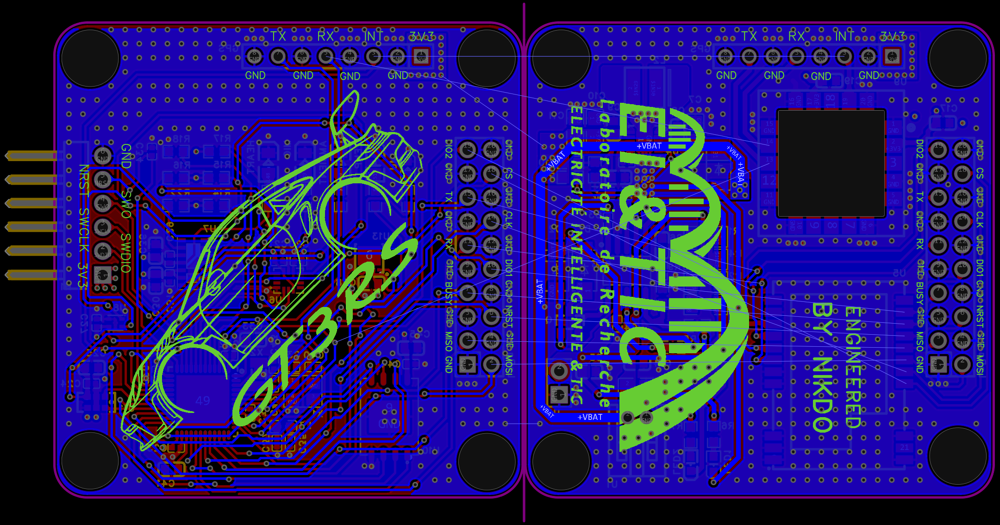

# Camel STM32L4 V2

A solar-powered wearable / tracker sensor node built as a **two-board stack**, with both boards on **4-layer PCBs**. It combines an STM32 microcontroller with motion, heart-rate, temperature and sound sensing, plus LoRa and GPS, all powered from a single LiPo cell charged by a solar panel.

| Top | Bottom |
|:---:|:---:|
|  |  |

## Mother / Daughter design

The project is split into two boards that stack **one on top of the other**:

| Board | Role | Main parts |
|-------|------|------------|
| **Mother** | Brain and sensors | STM32 MCU, IMU, heart-rate, skin and ambient temperature, microphone, flash memory, SWD header |
| **Daughter** | Power and communication | Solar charger, 3.3 V regulator, battery connector, LoRa module, GPS module |

The two boards connect through two matching headers:

- **LoRa header** (2×10, 2.54 mm): SPI bus and control lines for the LoRa module
- **GPS header** (1×8, 2.54 mm): 3V3, UART TX/RX, INT and GND

The boards stack on top of each other. Just line up the pins of the two headers and plug them together.

## Features

- **4-layer PCBs** (both boards)

**Mother board**
- **STM32U385CGU6** microcontroller (16 MHz crystal + 32.768 kHz RTC crystal)
- **LSM6DSVETR** 6-axis IMU
- **MAX30102** heart-rate / SpO2 sensor
- **MLX90632** infrared skin-temperature sensor
- **SHT41** ambient temperature and humidity sensor
- **MSM261DGT003** I2S MEMS microphone
- **W25Q256JVEIQ** 256 Mbit SPI flash
- One status LED per sensor (IMU, TEMP, AMBIENT, MIC, HEART)
- 6-pin SWD programming header

**Daughter board**
- **CN3791**: MPPT solar charger for a 1S LiPo (3.0 to 4.2 V)
- **TPS63060**: buck-boost converter for a stable 3.3 V rail
- **AO3401A**: P-channel MOSFET
- **SS14**: Schottky diodes (x3)
- **E22-900M22S**: LoRa module (SX1262, 868/915 MHz)
- **u-blox SAM-M8Q**: GPS module
- Solar panel header and battery connector (JST-PH 2-pin)
- CHARGING and DONE status LEDs

## SWD header (mother board)

| Pin | Signal |
|-----|--------|
| 1 | 3V3 |
| 2 | SWDIO |
| 3 | SWCLK |
| 4 | SWO |
| 5 | NRST |
| 6 | GND |

## LoRa header (2×10, both boards)

Pin 1 is the square pad. Odd pins are on one side, even pins on the other.

| Pin | Signal | Pin | Signal |
|:---:|--------|:---:|--------|
| 1 | GND | 2 | MOSI |
| 3 | MISO | 4 | GND |
| 5 | GND | 6 | NRST |
| 7 | BUSY | 8 | GND |
| 9 | GND | 10 | DIO1 |
| 11 | RX (RXEN) | 12 | GND |
| 13 | GND | 14 | CLK |
| 15 | TX (TXEN) | 16 | GND |
| 17 | GND | 18 | CS |
| 19 | DIO2 | 20 | GND |

## GPS header (1×8, both boards)

Pin 1 is the square pad.

| Pin | Signal |
|:---:|--------|
| 1 | 3V3 |
| 2 | GND |
| 3 | INT |
| 4 | GND |
| 5 | RX |
| 6 | GND |
| 7 | TX |
| 8 | GND |

## Power connectors (daughter board)

| Connector | Type | Pin 1 | Pin 2 |
|-----------|------|-------|-------|
| Solar panel | 2.54 mm 1×2 header | GND | +VSOLAR |
| Battery | JST-PH 2-pin | GND | +VBAT |

> Check the polarity on the silkscreen before connecting a battery or a solar panel.

## Files

- `SCH_Schematics_2026-11-09.pdf`: schematic
- `Camel_STM32L4_V2.step` / `.obj`: 3D models
- `Camel_STM32L4_V2_Gerber.zip`: manufacturing files

## License

This project is released under a license and is the property of the **EI&TIC laboratory** (Laboratoire Électricité Intelligente & TIC).

It is free to use, modify and share, but it is **not for commercial use**: it is a research project, not a product to sell, so please don't use it to make a profit.

## Author

**Becem Mhamdi**

[GitHub](https://github.com/becem2)

---

  <i>He who spares the wicked, harms the good.</i>

